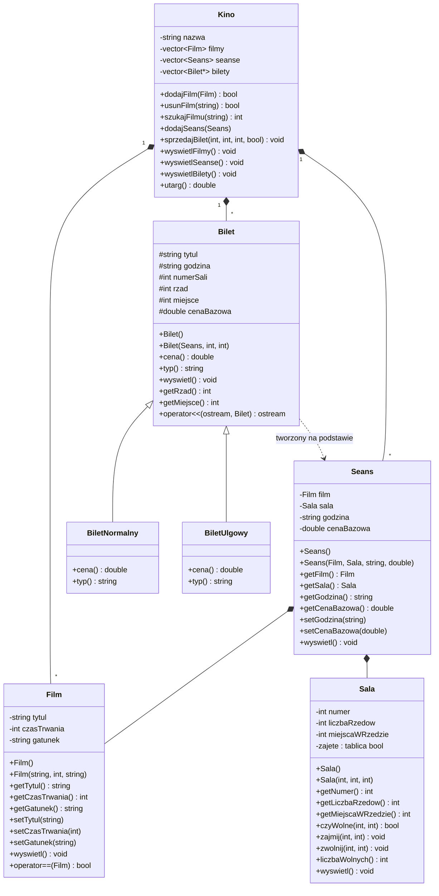

# System Sprzedaży Biletów w Kinie

Projekt zaliczeniowy z podstaw programowania obiektowego w C++. Konsolowy program do zarządzania filmami, seansami i sprzedażą biletów.

## Funkcjonalność
- dodawanie, usuwanie i wyszukiwanie filmów
- dodawanie seansów (film, sala, godzina, cena) i zmiana ceny
- podgląd sali z zajętymi i wolnymi miejscami
- sprzedaż biletów normalnych i ulgowych (70% ceny)
- lista sprzedanych biletów i utarg

## Architektura

| Klasa | Rola |
|-------|------|
| `Film` | tytuł, czas trwania, gatunek |
| `Sala` | układ miejsc, zajmowanie i zwalnianie |
| `Seans` | film + sala + godzina + cena bazowa |
| `Bilet` | klasa bazowa biletu (metody wirtualne `cena()`, `typ()`) |
| `BiletNormalny` | pełna cena |
| `BiletUlgowy` | 70% ceny bazowej |
| `Kino` | przechowuje filmy, seanse i bilety, obsługuje sprzedaż |

Zastosowane mechanizmy:
- **enkapsulacja**: pola `private`/`protected`, gettery i settery
- **dziedziczenie i polimorfizm**: `Bilet` -> `BiletNormalny`, `BiletUlgowy`; `Kino` trzyma `vector<Bilet*>` i wywołuje `cena()` oraz `typ()` polimorficznie
- **metody `const`** tam, gdzie nie modyfikują obiektu
- **przeciążenie operatorów**: `Film::operator==` (blokada duplikatów filmów), `operator<<` dla `Bilet` (wypisywanie biletów)
- **wyjątki**: `out_of_range`, `runtime_error`, `invalid_argument` (złe miejsce, zajęte miejsce, zły numer, ujemna cena), łapane w menu w `main.cpp`

## Diagram klas (UML)



Relacje: `Kino` jest właścicielem filmów, seansów i biletów (kompozycja, bilety zwalnia w destruktorze), `Seans` zawiera `Film` i `Sala`, a klasy `BiletNormalny` i `BiletUlgowy` dziedziczą po `Bilet`.

## Kompilacja i uruchomienie

Wymagany kompilator `g++` z obsługą C++17.

```bash
g++ -std=c++17 main.cpp Film.cpp Sala.cpp Seans.cpp Bilet.cpp BiletNormalny.cpp BiletUlgowy.cpp Kino.cpp -o program
./program
```
Na Windowsie (PowerShell) uruchomienie: `.\program`.

## Przykład działania

Sprzedaż biletów na pierwszy seans:
```
Wybor: 9
1. 18:30 | Interstellar (sci-fi, 169 min)
   sala 1, cena: 25 zl, wolnych miejsc: 40
2. 20:00 | Incepcja (sci-fi, 148 min)
   sala 2, cena: 28 zl, wolnych miejsc: 24
Numer seansu: 1
...
Rzad: 2
Miejsce: 3
Typ biletu (1 - normalny, 2 - ulgowy): 1
Sprzedano bilet
```

Lista sprzedanych biletów po sprzedaży normalnego i ulgowego:
```
Wybor: 10
1. [Normalny] Interstellar, 18:30, sala 1, rzad 2, miejsce 3, cena: 25 zl
2. [Ulgowy] Interstellar, 18:30, sala 1, rzad 2, miejsce 4, cena: 17.5 zl
Utarg: 42.5 zl
```

Próba sprzedaży zajętego miejsca:
```
Blad: Miejsce jest juz zajete
```\\